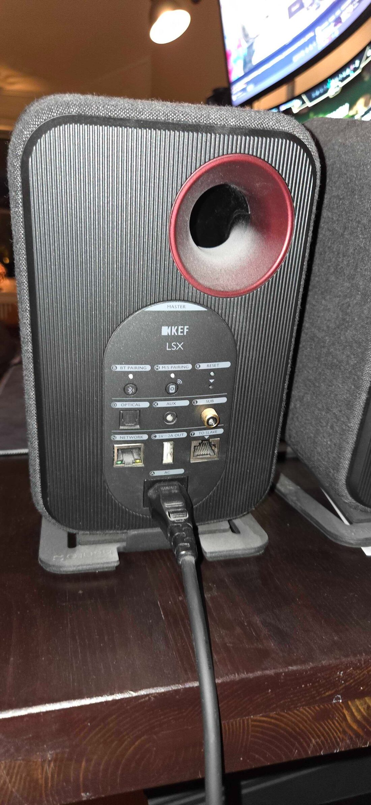
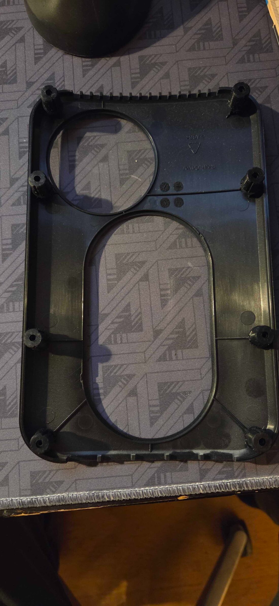
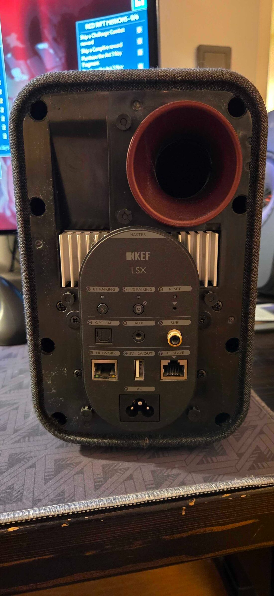
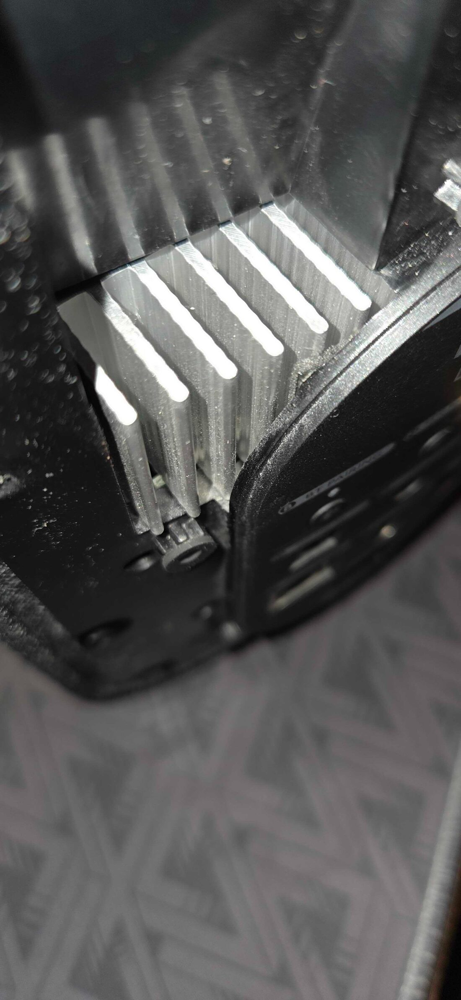
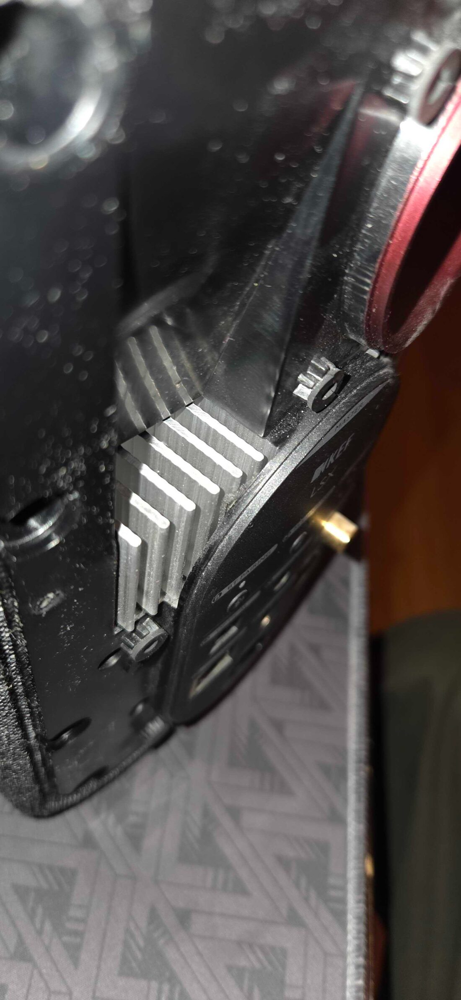
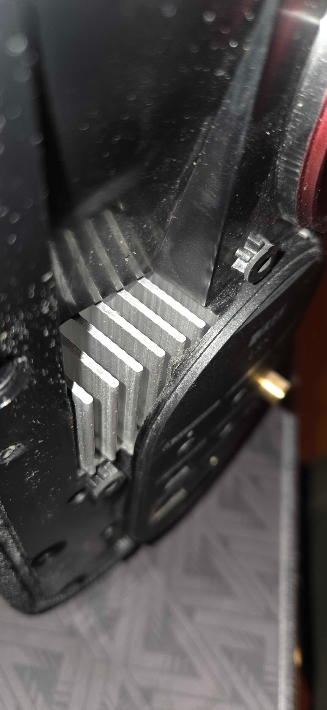
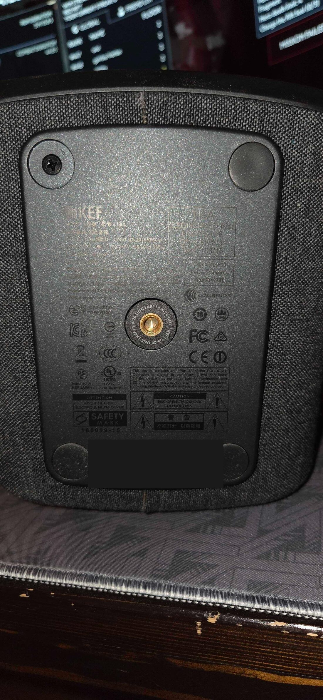
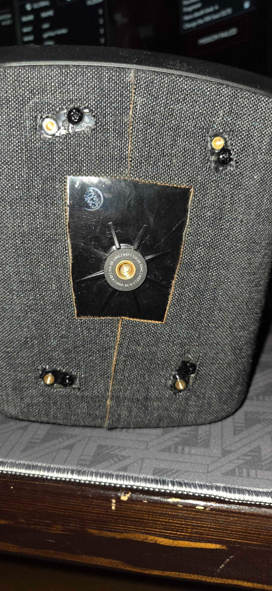
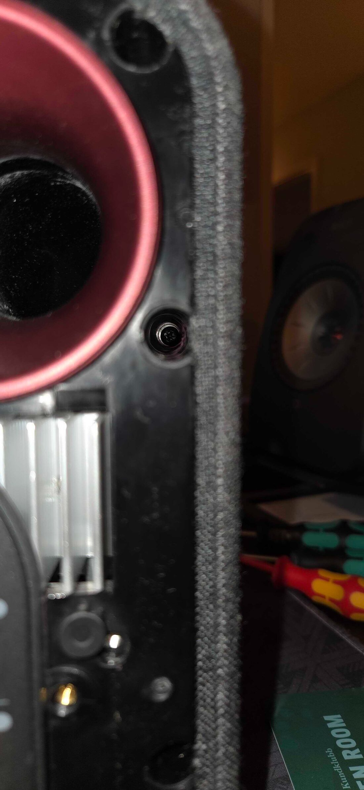

# UART plan — streaming module

The goal is **not** a root shell. We established from the firmware that the
streaming module is a Microchip/SMSC DMP (ARM9) running **ThreadX** — no POSIX,
no shell, no userland. What UART buys us is different and still valuable:

1. **The boot log.** Load addresses, and the device's own verdict when it
   rejects an image. That is the fastest way to answer "signature or checksum?"
   without guessing at disassembly.
2. **A memory dump.** Real flash contents, including the per-unit calibration
   and NVRAM that the public `.fw` does not contain.
3. **A recovery path.** The prerequisite for ever attempting a modified image.

Point 3 is the reason this comes before any flashing experiment. Do not write a
modified image to a device with no recovery route.

## Before you open anything

* **Master speaker only.** The slave does not run the network stack.
* **Work unplugged**, then power up only when you are ready to capture.
* **3.3 V logic.** A 5 V USB-UART adapter on 3.3 V pads can kill the SoC. Use a
  CP2102/FT232RL board with a **3.3 V** jumper setting, and confirm it with a
  multimeter before connecting.
* **Never connect VCC.** GND, TX, RX only. The board is already powered; feeding
  it is how you get two supplies fighting.
* Opening the cabinet risks cosmetic damage. Photograph everything as you go.

## Prior art (someone has done this)

Two documented teardowns exist, and they answer most of the open questions.

### AudioScienceReview: "KEF LSX Teardown and Repair"

<https://www.audiosciencereview.com/forum/index.php?threads/kef-lsx-teardown-and-repair.55697/>

Full component list from the **MAMP board** (Master Amplifier):

| Part | Role |
|---|---|
| **Microchip CY920-C** | **Wi-Fi/BT Network Media Module (our DMP)** |
| Analog Devices ADAU1451WBCPZ | 32-bit DSP, 294.912 MHz |
| ST STM32F030 | ARM Cortex-M0 MCU |
| Cirrus Logic CS4272 | 24/192 stereo codec |
| TI PCM1754 | 24/192 stereo DAC |
| Cirrus/Wolfson WM8805 | S/PDIF transceiver |
| Qualcomm/CSR CSRA64215 | Bluetooth 4.2 BLE |
| TI CC8520 | PurePath 2.4 GHz wireless audio, master-to-slave link |
| TI TPS5430, TPS54260 | buck converters |
| (under PCB, on heatsink) | power amp, likely TI TPA32xx |

**Enclosure:** "No screws can be seen from the outside; they are hidden by the
back cover, which is **pressure-mounted**." Cabinet is mostly plastic with thin
wood sides wrapped in cloth, plus a brace behind the driver magnet. Four
antennas: BT (lower right), PurePath (top), two WLAN (top left on screws, top
right on the brace with plastic pins).

**Known failure mode:** blinking red/orange (absent from the manual) means general
failure. Root cause found: **C433 cracked** (1206 ceramic, likely X5R, apparently
16 V rated and under-rated for the rail) and **RF choke L236/L238 burned out**.
That kills the +12 V rail from U20 (LM29150-12), fed by a Q211/Z203 pre-regulator.
Fix is a few cents of parts.

### Darko.Audio: LS50 Wireless internals

<https://darko.audio/2017/03/one-more-time-with-feeling-the-kef-ls50-wireless-at-6moons/ls50-wireless-internals/>

Board photos for the sibling product, useful for orientation.

## The module is a documented part, and its debug port is named

The CY920 is a standard Microchip Network Media Module built on the **DM920**
multi-core network media processor. Its block diagram enumerates the interfaces:

```
DM920 SoC
  RST | 10/100 Ethernet + PHY | USB 2.0 OTG
  Serial Flash SPI 1 (16 MB) | I2C | HD ports
  2x I2S, S/PDIF | AV ports
  DEBUG PORT UART 1        <-- the shell
  JTAG
  SPI 0 | GPIO
  UART 0 -> Bluetooth baseband
  DDR2 controller (64 MB)
```

**"Debug Port UART 1"** is the module's own name for it, and the KEF config
matches: `Shell = UART1`. So the console is a documented feature of the part, not
something KEF invented or removed.

Microchip documents it further: *"To view shell logs, connect the USB to serial
adapter or connect the RS232"* and *"On powering, the Bootloader software is
executed."* The console carries bootloader output.

Documents to obtain (Microchip blocks automated fetches, so these need a browser):

* **DS60001270** CY920 Network Media Module Data Sheet (pinout)
* **DS50002260B** CY920 Getting Started Guide (serial console setup)

The module connects through a **200-pin SODIMM-style connector** (basic
connector, plus an optional extended connector on some SKUs). On the CE2
evaluation board that is a socket. On the KEF MAMP board it appears to be
soldered down, so the debug pins are most likely reachable as test pads or vias
routed to the UART1 nets rather than by removing the module.

Note the name collision: searching "DM920" mostly returns the **Dreambox DM920**
satellite receiver, an unrelated product. Always search "CY920" or "DM920
Microchip".

## Two cheaper experiments the rear panel suggests

Both are safe and need no disassembly. Try these before the screwdriver.

**1. Tap the `TO SLAVE` link.** It is an **RJ45** — the inter-speaker link is
Cat5-class, not a proprietary 2-wire bus. The slave has never been examined: it
does not answer on 50001 and we have never seen its services. Options:

* Put a managed switch between master and slave and mirror the port.
* Substitute a laptop for the slave and see what the master does, or connect a
  laptop to the slave's side and scan it.

Worst case the link is not standard Ethernet and nothing negotiates. Nothing
breaks.

**2. Mirror the `NETWORK` port on a managed switch.** This is the clean way to
get the passive packet capture that was wanted for OTA/DNS observation — no root
on the speaker, no MITM, no ARP spoofing. If the speaker is plugged into a
switch that supports port mirroring, a mirror of its port gives every DNS query
and HTTP request it makes.

Given that the firmware turned out to be downloadable directly, the OTA capture
matters less than it did — but a mirror is still the easiest way to watch what
the speaker phones home to, which is its own useful question.

## How it comes apart, photographed

Photographed on a real unit (2026-11-04). All images are in
[`images/teardown/`](images/teardown/). Master speaker only.

**Safety first:** the MAMP board shares its enclosure with a switch-mode PSU
using 600 V MOSFETs. Disconnect mains and wait 5 to 10 minutes before working
inside. Keep probes clear of the bottom third of the cavity.

### 1. The rear as shipped



A single smooth oval module carrying every connector. **No visible fasteners
anywhere.** This is where most people stop.

### 2. The cosmetic panel comes off first



The panel is a separate part, retained by **eight rubber posts press-fitted into
holes**. Work a plastic pry tool around the perimeter in small increments. The
embossed `FRONT` arrow is an assembly orientation aid.

The two large cutouts surround the bass port tube and the connector module, so
the panel must come off straight, not hinged.

### 3. Underneath: the heatsink plate



The black plate with the connector module is the **heatsink and amplifier plate**,
and the module is one piece with it, not a separate removable part. Silver fins
are visible in two windows. Perimeter screws are now accessible.

### 4 to 6. Plate edge detail





These show the small black cylindrical posts along the plate edge. They look like
pressure-distribution grommets, and that is exactly what they are easy to mistake
for. **Read step 9 before you conclude the plate is glued.**

### 7. Under the rubber feet



The underside has four rubber discs. They lift out to reveal more fasteners. The
central `1/4"-20 UNC` brass insert is the stand or wall-mount thread and is not a
fastener.

### 8. The base corners



Each corner has a brass insert (not a fastener) and a black screw (a fastener).
The fabric is scuffed at these points and tucks back in on reassembly.

### 9. The step nobody documents



**This is the one.** The black cylindrical posts each contain a **screw recessed
deep down inside a bore**. These clamp the back plate to the **front baffle**,
which is why the plate stays absolutely rigid after every other screw is out.

You need a long, thin-shafted driver to reach them. A standard handle and a
1/4-inch bit will not clear the bore. Magnetise the bit: a dropped screw falls
into the cabinet, and one was already rattling inside this unit before the plate
came free.

### Retention summary, in the order you meet it

| Stage | What | Count |
|---|---|---|
| 1 | Rear cosmetic panel on rubber posts | 8 posts |
| 2 | Plate perimeter screws | about 6 |
| 3 | Screws under the rubber feet | 4 |
| 4 | **Recessed screws inside the plate standoff posts** | one per post |

Roughly fourteen to eighteen fasteners in total. Step 4 is the one that makes the
plate feel glued when it is not.

### Reassembly

Reverse the order: standoff screws first (they carry the clamping load to the
baffle), then feet screws, then perimeter screws, then press the cosmetic panel
onto its eight posts. The rubber posts may have lost grip, so a little fresh
adhesive or tape helps. A dab of fabric adhesive tidies the corners at the feet.

## Finding the header

Look on the main board, near the DMP (the largest QFP/BGA with the heatsink or
shield nearby, usually the one with the crystal and the DDR).

Candidates, in order of likelihood:

* A 4-pin unpopulated through-hole footprint, often silkscreened
  `J1`/`J2`/`CON`/`DEBUG`, sometimes labelled `TX RX GND 3V3`.
* Four round test pads in a row, 2.54 mm or 1.27 mm pitch.
* A 6-pin header where two pins are NC — the extra pins are often
  `BOOT`/`RESET`, which are useful later.
* Bare vias with no silkscreen. Probe these last.

A USB microscope or phone macro shot of the silkscreen saves a lot of guessing.

## Interfacing: what to buy and what to do

### Shopping list

| Item | Notes |
|---|---|
| USB-UART adapter | CP2102, FT232RL or CH340. Must support **3.3 V logic** and **230400 baud**. Set the voltage jumper to 3.3 V and verify with a multimeter before connecting anything |
| Dupont leads or probe clips | Clips avoid soldering to pads |
| Multimeter | GND identification, and verifying the adapter's logic level |
| 8-channel logic analyser (optional, cheap) | Turns pin identification from trial-and-error into a 30-second job |

### Hazards specific to this unit

The MAMP board shares its enclosure with a switch-mode PSU using 600 V MOSFETs
(Infineon IPD60R360P7). Therefore:

* Disconnect mains and wait 5 to 10 minutes for the capacitors to discharge
  before attaching wires. This matches the warning KEF's own repair guidance
  gives for their amplifier plates.
* Keep probes and fingers clear of the PSU section.
* **Never connect the adapter's VCC.** The board is already powered.
* 3.3 V logic only. A 5 V adapter on a 3.3 V pad can destroy the SoC.

### Pin identification, in order

1. **GND** by continuity to chassis or ground plane. The anchor for everything.
2. **VCC** (steady 3.3 V), identified only so you know to avoid it.
3. **TX** (device to host): idles near 3.3 V and wiggles during boot. On a logic
   analyser, decode at 230400 8N1 and it appears instantly. Without one, probe
   candidates with the adapter and watch for readable text.
4. **RX** (host to device): idles high, no activity. Only needed for typing.

Start with **GND and TX only**. Listening cannot damage anything.

### Expected result

Press `<Enter>` repeatedly until the prompt appears:

```
sds://>
```

Then, in this order:

```
sds://> rd 0xe060b100
```

Settles the descriptor question (flash vs fuse).

```
sds://> cd cne/Application/NetIF
sds://> ls -v
```

Confirms `set` and `ls -v` behave as documented. Then set the telnet shell key,
reboot, and port 8000 serves the same shell over the network.

### Troubleshooting

| Symptom | Likely cause |
|---|---|
| Garbage characters | Wrong pin, or wrong baud. Try 115200 as a fallback |
| Silence | On RX instead of TX, or wrong pin. Swap candidates |
| Noise only during boot | On a clock or data line, not UART |
| No `sds://>` prompt | Keep pressing Enter; the guide says to |

## UART has no standard physical form

Worth stating because it determines what you buy. UART is a signalling
convention (TX, RX, ground), not a connector, so how it appears varies:

| Presentation | How you attach |
|---|---|
| 0.1 inch header, populated | Female dupont, direct |
| 0.1 inch holes, unpopulated | Solder a pin, or a pogo pin |
| **Bare flat test pads** | **Dupont cannot grip.** Solder, pogo, or needle probe |
| Vias, tented or open | Needle probe, or scrape and solder |
| Dedicated connector (JST-SH, PicoBlade, FPC) | Matching connector or adapter |
| Card-edge / SODIMM contacts | Matching socket (this is the CY920 module itself) |
| Only on chip pins | SOIC clip or needle probe, with short-circuit risk |
| Not broken out | Multiplexed elsewhere or disabled in firmware |

The CY920 debug port is most likely exposed as **flat gold pads** on the MAMP
board, which is the one case a female dupont lead cannot grip.

### When clip-on leads are the right answer

* Pads are flat, so there is nothing to insert into.
* Pitch is small and solder would bridge neighbours.
* You want **several candidates probed at once**, for a logic analyser or a
  multi-channel sniffer. Soldering eight tails is miserable; clips or pogo pins
  are the sane choice.
* The board sits in a cavity and cannot be approached straight on.
* You do not want to solder at all.

### Which lead for which job

| Lead | Works on | Notes |
|---|---|---|
| Female dupont | 2.54 mm pins only | What the FTDI cable has |
| Mini grabber / test hook | Component legs, wires, header pins | Needs something to hook around |
| SOIC / IC clip | Chip legs | Can bridge adjacent pins |
| **Pogo pin / spring probe** | **Flat pads** | Correct tool here |
| Needle probe | Anything, briefly | Fine for identifying, poor for capturing a boot log |
| Solder plus thin enamelled wire | Anything solderable | Most reliable, reversible with solder wick |

Test pads are designed to be probed and soldered to, so soldering short tails is
low risk. Pogo pins are better if you want to sample many pads at once.

**Check this before buying probes:** the ~14-pad row may be an **unpopulated
connector footprint** rather than individual test points. If the pads sit on a
regular pitch with a silk outline, it may want a ribbon or FPC connector, and the
correct answer is a matching connector rather than clips.

## Target: the pad row on the MAMP board

The teardown photos show a **row of roughly fourteen bare gold pads** in the
middle of the MAMP board, just above the PSU section. It is an unpopulated
programming/test header and it is the most likely landing place for UART1 and
JTAG. The CY920 itself is under an RF shield (the labelled metal can with the
MAC address), so the debug signals are routed out to the PCB rather than being
directly reachable on the module.

Plan once the panel is off:

1. **Photograph the board at high resolution**, especially the pad row and the
   CY920 footprint, before touching anything.
2. **Find GND** among the pads by continuity to the chassis.
3. **Measure each pad's idle level.** TX and RX sit near 3.3 V. JTAG TCK/TMS may
   sit low or float. This narrows the candidates fast without a scope.
4. **Clip a logic analyser across all of them** during boot if available. At
   230400 8N1 the TX line decodes instantly and the guesswork ends.
5. Otherwise probe candidates with the adapter at 230400 while watching for text.
6. Connect **GND and TX only** first.

Keep probes out of the bottom third of the cavity: the PSU board with its large
capacitors and transformer lives there.

## Identifying the pins

With the board powered and a multimeter:

| Pin | Test |
|---|---|
| **GND** | Continuity to chassis/shield/ground plane. Find this first. |
| **VCC** | Steady 3.3 V (sometimes 1.8 V — check before assuming). |
| **TX** (device → you) | Idles high near 3.3 V, and **wiggles during boot**. This is the one you want. |
| **RX** (you → device) | Idles high, no activity. Optional at first. |

Start with **GND + TX only**. You can capture the entire boot log with just
those two wires, and you cannot damage anything by listening. Add RX later, and
only if you need to type at a prompt.

A cheap 8-channel logic analyser makes TX identification near-instant: probe all
four pads, power on, and read the serial decode off whichever channel shows
framed data.

## Capturing

**Use 230400 8N1, no flow control.** This is documented, not a guess: the
Microchip CY920 Getting Started Guide (DS50002260B) shows the console setup as
`Baud rate 230400, Data 8 bit, Parity none, Stop 1 bit, Flow control none`, and
the screenshot of the working session is titled `COM8:230400baud`.

(Earlier revisions of this document suggested trying 115200 first. That was a
guess from the `uartcfg` help text, which merely uses 115200 as an example value.
The console default is 230400.)

```sh
# adjust the device node
picocom -b 115200 --imap lfcrlf /dev/ttyUSB0
# or, for a clean log file:
stty -F /dev/ttyUSB0 115200 raw -echo
cat /dev/ttyUSB0 | tee captures/uart-boot-$(date +%s).log
```

Power-cycle the speaker **while the capture is running** and let it boot fully.
Expect some or all of:

* DDR init messages (we know the strings: `Init DDR Done`, `Phy Init`,
  `upctl:POWSTAT`)
* load addresses and section sizes — the thing static RE could not give us
* `checksum failed` / `Sirius` / `Keyblob` / `Certificate` / `bad signature` on
  the verification path
* `LSX Microchip MCU Application V5.2.0` and `Application initializing.`
* ThreadX startup and the GoAhead web server coming up

**Capture the boot log before touching anything else.** It is read-only,
risk-free, and answers the most valuable open question.

## What you should see (documented)

The prompt is **`sds://>`**. The Getting Started Guide shows the expected session:

```
Wlan init
Disabling M3
Enabling M3
Starting IPOD DETECTION and IDPS
sds://>
```

The boot log is **very verbose**: the guide's screenshot is full of
`FATAL TRACE ERROR` lines carrying source file and line numbers
(`UIMgr/PlayModeHandler.cpp[1101]`, `UIRemoteControlOnlyModeHandler.cpp[163]`),
including complaints about Pandora and Flickr services. Expect a lot of output,
and expect it to name internal files. Press `<Enter>` repeatedly if the prompt
does not appear.

## The shell, and the persistence chain

Documented shell session from the guide:

```
sds://> cd cne/Application/NetIF
sds://> ls -v
sds://> set CurrentMode wired
sds://> netcfg
```

So `set <attribute> <value>` writes **arbitrary CnE keys**, and `cd`/`ls -v`
navigate the config store. Combined with the command set recovered from the
firmware (`rd`, `wr`, `reg`, `bat`, `uartcfg`, `iperf`, `nslookup`,
`upnp av dump`, `lui`, `st trace`), one UART session is enough to do all of this:

1. **`rd 0xe060b100`** answers the last open question: is the Fletcher-32
   descriptor flash-backed or fuse-backed.
2. **`set TelnetShellEnable 1`** (or the equivalent path) enables the telnet
   shell, after which **port 8000** gives the same shell over the network and the
   UART adapter can be retired.
3. Full flash dump via the bootloader's `Read flash out. Start xmodem now!`.

That makes UART a one-time cost, not an ongoing tether.

## If there is a prompt

A ThreadX vendor CLI may offer commands. Look for, in rough order of value:

* `help` / `?`
* memory read: `md`, `dump`, `peek`, `rd`
* flash read: `flash`, `nand`, `mtd`
* boot control: `boot`, `reset`, `go`
* environment: `env`, `printenv`, `setenv`

Do **not** run anything that writes until the boot log is captured and you have
a full flash dump on disk, verified twice.

## If there is no prompt

Next step is **JTAG/SWD**, not more UART guessing. Look for a second header
(typically 10- or 20-pin, or 4 pads labelled `TCK TMS TDO TDI`). ARM926EJ-S is
old enough that JTAG is usually fully open — no secure debug lockdown like
modern SoCs. With JTAG you can halt the core, read memory directly, and bypass
the bootloader's verification entirely.

## What to dump, in order

1. Full boot log.
2. Bootloader / section 1 region (first 256 KB of flash).
3. The application partition.
4. Anything that looks like NVRAM, calibration, or settings — that is the data
   the public firmware image does not contain.
5. Hash everything twice and keep a second copy off-machine.

## Then, and only then

With a verified dump and a working recovery route, a modified-image experiment
becomes reasonable: serve a deliberately corrupted image through the OTA or USB
path and observe the rejection message. If the device merely checks a CRC, it
will accept a repacked image; if it verifies a signature, it will refuse — and
either way we learn the answer from the device rather than from disassembly.

Without a recovery route, that experiment risks a dead speaker for no gain.
